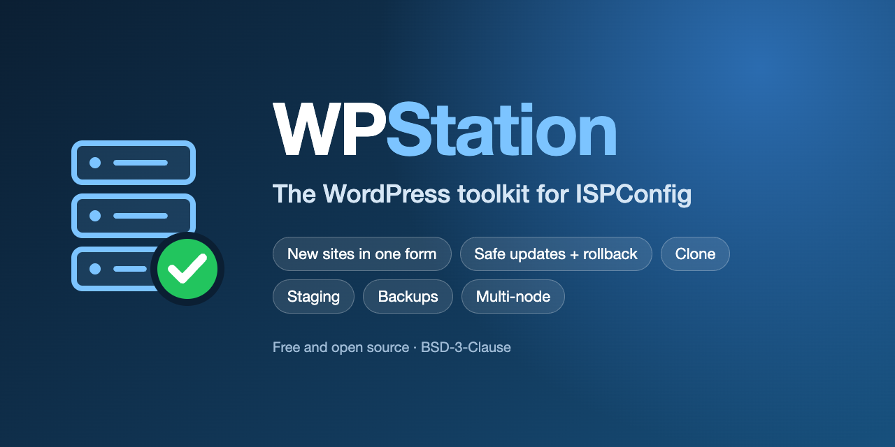
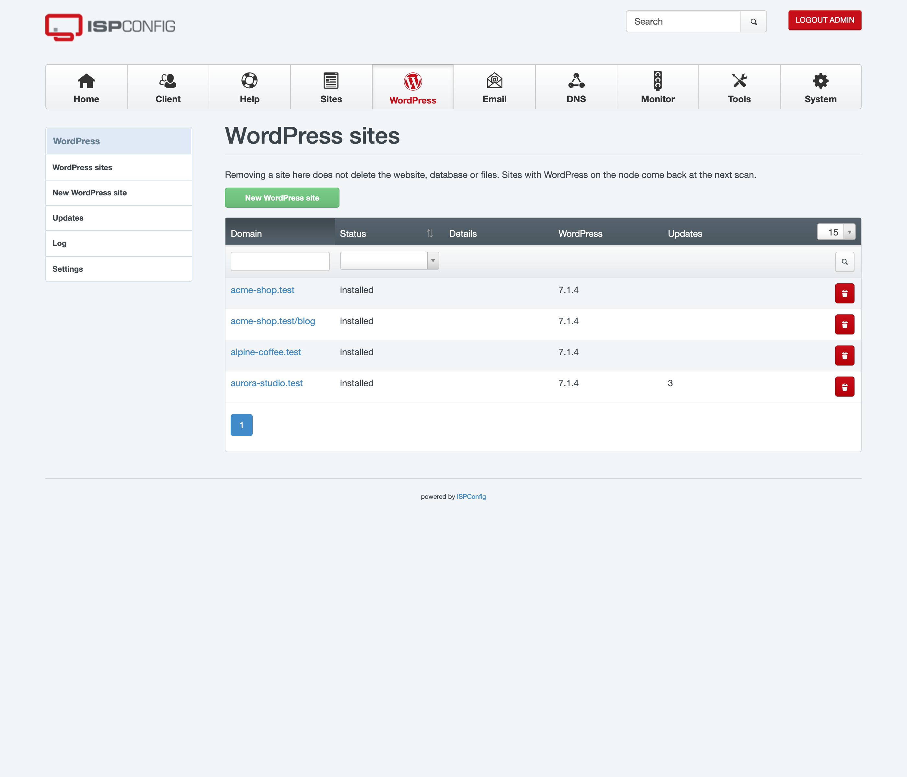
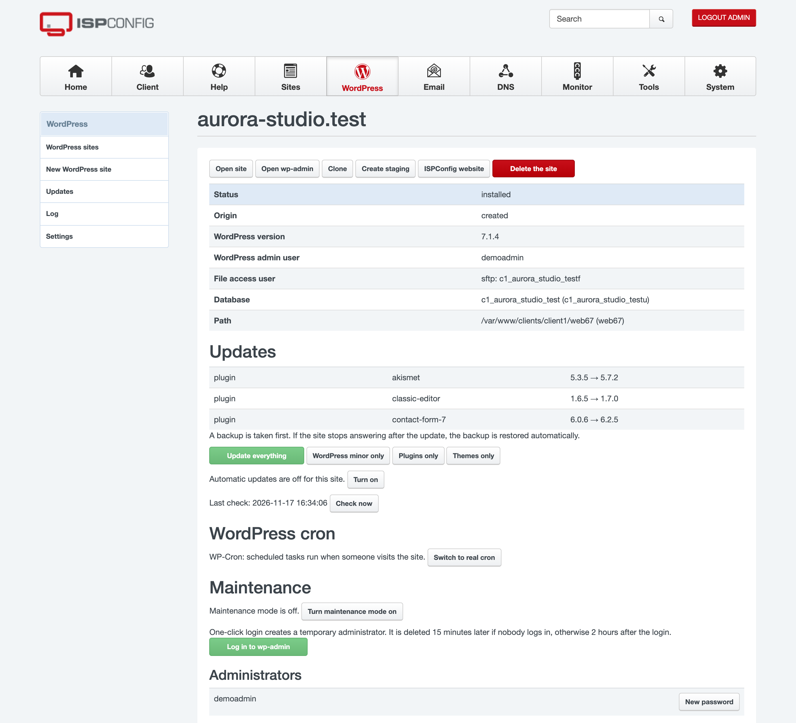
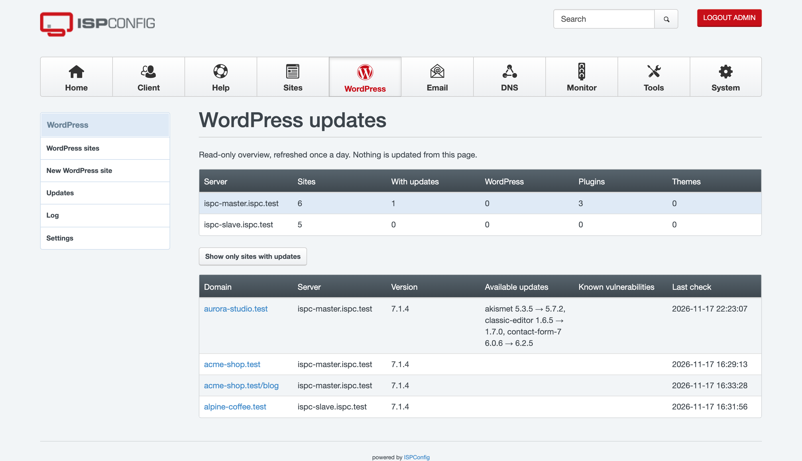
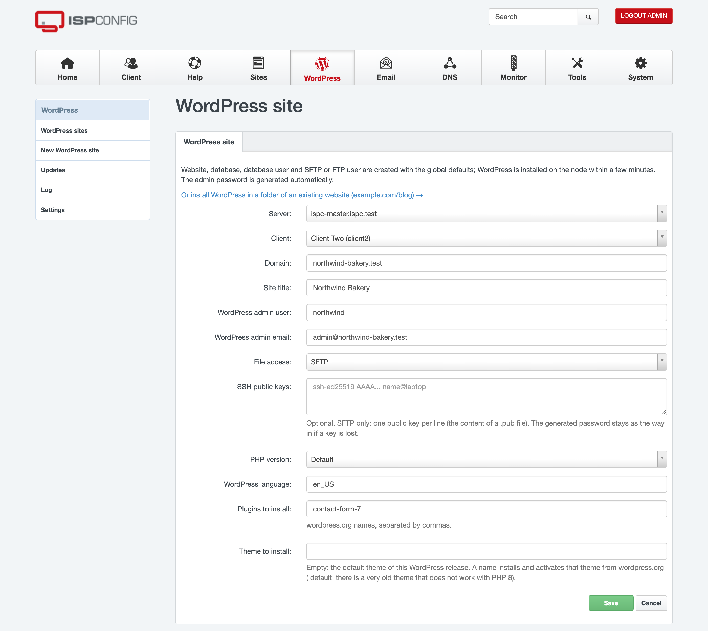
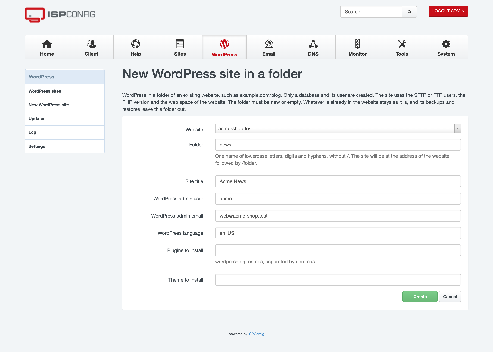
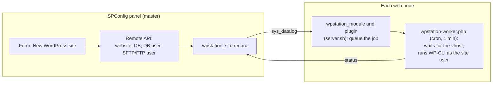

<p align="center">
  
</p>

<p align="center">
  <a href="https://github.com/stekky81/ispconfig-wpstation/actions/workflows/ci.yml"></a>
  <a href="LICENSE"></a>
  
  
  
</p>

**WPStation** adds a WordPress menu to [ISPConfig 3](https://www.ispconfig.org): create, update, clone and stage
WordPress sites across one or more nodes, with a backup, a health check and an automatic rollback around every change.
Free and open source, a self-hosted alternative to commercial "WordPress toolkits".

> [!WARNING]
> **Pre-release: use at your own risk.** WPStation has passed its test plan on test servers, not yet on production.
> It creates websites, databases and system users and runs commands on your nodes. Try it on a disposable ISPConfig
> server, keep backups, and read the code first. The authors accept no liability for data loss or downtime
> (see [LICENSE](LICENSE)).

<p align="center">
  
</p>

## Why WPStation

- **Updates you can leave running.** Every update gets a backup before and a health check after; when the site breaks,
  it is rolled back on its own and you get an email.
- **Copies in one click.** Clone a site to a new domain, on the same node or another one, or give it a staging copy
  that you push back to production when it is ready.
- **Made for ISPConfig.** Websites, databases, users and cron jobs are created through ISPConfig itself, on every node,
  and your clients and resellers use it on their own sites within their limits.
- **Careful by design.** Dry-run by default, never a non-empty folder, everything as the site user, every WP-CLI command
  in a PHP sandbox, a log of who did what.

WPStation is an independent project: it is not the official "WordPress Manager" extension of ISPConfig.
Until November 2026 it was called `ispconfig-wp-manager`.

## Features

**Sites**

- **New WordPress site**: website, database, database user, SFTP or FTP user and WordPress in one form, with per-site
  PHP version, language, plugins, theme and SSH keys; defaults on a settings page.
- **Existing sites**: WordPress installs already on the nodes are found and added to the list.
- **Sites in folders**: WordPress in `example.com/blog` of an existing website, with its own database.
- **Full removal**: website, domains, users, cron jobs, databases and the database users nobody else uses, listed
  before a typed confirmation.

**Updates**

- **Overview** of core, plugin and theme updates of every site, per node and per site.
- **Safe updates** with backup, health check and automatic rollback, and a separate button for a new major version of
  WordPress.
- **Who updates each site**: WordPress as before, WPStation for plugins and themes, or WPStation for everything; the
  automatic updates of WordPress are turned off where WPStation takes over, so nothing is updated twice.
- **Backups and restore** from the site page, optionally without `wp-content/uploads`. They are meant for rollbacks and
  do not replace the backups of ISPConfig.

**Copies**

- **Clone** to a new domain on the same node or another one, replacing the old address everywhere in the database,
  serialized data included.
- **Staging**, one per site: no mail from PHP, hidden from search engines, updated from production or pushed to
  production with a list of what will be lost, typed confirmation, backup and automatic rollback.

**Tools**

- Maintenance mode that lets logged-in users through, one-click login to wp-admin, password reset of an administrator,
  debug mode with the log outside the web root, plugins and themes on and off with a health check.
- Switch between WP-Cron and a real cron job.

**Security and operations**

- Known vulnerabilities of WordPress, plugins and themes from Wordfence Intelligence (with your own free API key), with
  an email and an early automatic update when a fixed version exists.
- File permission check and fix, hardening switches per site.
- Clients and resellers manage their own sites, within the limits of their ISPConfig package.
- A log of who asked for what in the panel, with the outcome on the node.
- Emails through the mail settings of ISPConfig: site ready (never with passwords), rollbacks and failures at once, a
  daily or weekly summary.

> [!IMPORTANT]
> Automatic updates start as soon as `dry_run` is turned off, for the sites WPStation created. Sites it finds on a node
> stay with the updates of WordPress until you choose otherwise. To look at a node without any update by WPStation, set
> `updates.auto` to `n` first. See
> [docs/installation.md](docs/installation.md).

## Screenshots

| | |
|:-:|:-:|
| <br>**The page of a site**: status, backups, updates, tools | <br>**Updates** of every site at a glance |
| <br>**A new site** from one form | <br>**WordPress in a folder** of an existing website |

## Quick start

On a **test server** with ISPConfig 3.3 and [WP-CLI](https://wp-cli.org):

```bash
git clone https://github.com/stekky81/ispconfig-wpstation /opt/ispconfig-wpstation
sudo /opt/ispconfig-wpstation/install/install.sh --role=master --role=node   # single server
```

Then add an ISPConfig remote user to `/opt/ispconfig-wpstation/config.php` and enable the `wpstation` module for your
admin user. Multiserver setups, the remote user's permissions and the step from dry-run to real changes are in
[docs/installation.md](docs/installation.md).

## Requirements

- ISPConfig 3.3 (tested on 3.3.2 and 3.3.3), single server or multiserver; see
  [docs/compatibility.md](docs/compatibility.md)
- PHP 8.1+ with the `sodium` and `curl` extensions on the master and on every web node
- [WP-CLI](https://wp-cli.org) in `/usr/local/bin/wp` on every web node, plus `sudo`, `rsync`, `tar`, `gzip`
  and a MySQL or MariaDB client
- A dedicated ISPConfig remote user (System → Remote Users)

## How it works



Details in [docs/architecture.md](docs/architecture.md).

## Documentation

- [Installation](docs/installation.md)
- [Administrator guide](docs/admin-guide.md): daily use, and what to do when something goes wrong
- [Client guide](docs/client-guide.md): what clients and resellers can do, to pass on to them
- [Compatibility](docs/compatibility.md): what WPStation has run on, and how far
- [Architecture](docs/architecture.md) and [security](docs/security.md): how it works and what it protects
- [Roadmap](ROADMAP.md) and [changelog](CHANGELOG.md)

## Help test it

**Testers wanted**, especially on nginx, Debian, MySQL or with a separate database server. A disposable server and an
hour are enough: see [docs/testers.md](docs/testers.md).

Automated tests cover the logic that needs no live server, and integration tests run it against real users, MariaDB
and WordPress in the CI; the rest follows the manual test plan in [docs/testing.md](docs/testing.md).

```bash
composer install
composer test
```

## Security

The design, what a review found and the risks that remain are in [docs/security.md](docs/security.md).
To report a vulnerability, see [SECURITY.md](SECURITY.md).

> [!IMPORTANT]
> WP-CLI runs outside the jail of a site, as its own user, limited by a PHP sandbox that is not a jail. If you rely on
> the jail to contain your clients, read [WP-CLI runs outside the jail](docs/security.md#wp-cli-runs-outside-the-jail)
> first.

## Contributing

Contributions are welcome: see [CONTRIBUTING.md](CONTRIBUTING.md).

## License

BSD 3-Clause, the same license as ISPConfig. See [LICENSE](LICENSE).
ISPConfig and WordPress are trademarks of their respective owners; this project is not affiliated with them.
