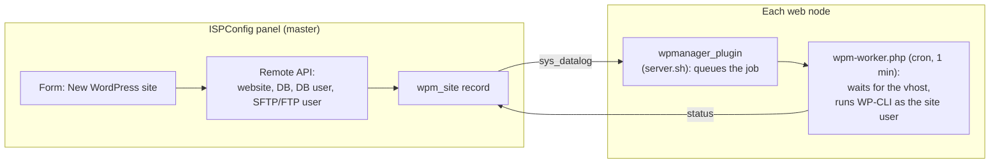

# ispconfig-wp-manager

> [!WARNING]
> **Pre-release software — use at your own risk.**
> This project is in an early development stage and has **not** been validated on production servers.
> It creates websites, databases and system users and runs commands on your nodes.
> Test it only on a disposable ISPConfig installation (for example a VM snapshot), keep backups,
> and read the code before running it. The authors accept no liability for data loss or downtime
> (see [LICENSE](LICENSE)).

An [ISPConfig 3](https://www.ispconfig.org) module to deploy, clone and keep WordPress sites updated
across one or more ISPConfig nodes — a free, open source alternative to commercial "WordPress toolkits".

## Goals

- **One-click WordPress site**: website, database user, database, SFTP or FTP user and WordPress install
  in a single form, with global defaults (PHP version, quotas, SSL, plugins, hardening).
- **Update overview**: see core, plugin and theme updates for every WordPress install on every node.
- **Clone**: copy an existing site to a new domain (files, database, search-replace).
- **Safety first**: dry-run mode, no changes to directories that are not empty, backups before updates.

## Status / roadmap

| Milestone | Scope | Status |
|-----------|-------|--------|
| 0.1 | Module skeleton, installer, config, tests | in progress |
| 0.2 | New WordPress site (MVP) | planned |
| 0.3 | Inventory and update check of existing installs | planned |
| 0.4 | Updates with pre-update backup and rollback | planned |
| 0.5 | Clone site | planned |

The detailed list of planned work is in [ROADMAP.md](ROADMAP.md).

## How it works



Details in [docs/architecture.md](docs/architecture.md).

## Requirements

- ISPConfig 3.2 or later (single or multiserver)
- PHP 8.1+ with the `sodium` extension on the master and on every web node
- [WP-CLI](https://wp-cli.org) on every web node
- A dedicated ISPConfig remote user (System → Remote Users) with the permissions listed in
  [docs/installation.md](docs/installation.md)

## Installation

See [docs/installation.md](docs/installation.md). **Read the warning above first.**

## Testing

Automated tests cover the logic that does not need a live server; everything else follows the
manual test plan in [docs/testing.md](docs/testing.md).

```bash
composer install
composer test
```

## Contributing

Contributions are welcome — see [CONTRIBUTING.md](CONTRIBUTING.md).

## License

BSD 3-Clause, the same license as ISPConfig. See [LICENSE](LICENSE).
ISPConfig and WordPress are trademarks of their respective owners; this project is not affiliated with them.
