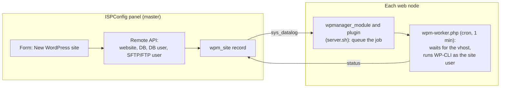

# ispconfig-wp-manager

> [!WARNING]
> **Pre-release software — use at your own risk.**
> This project is in an early development stage and has **not** been validated on production servers.
> It creates websites, databases and system users and runs commands on your nodes.
> Test it only on a disposable ISPConfig installation (for example a VM snapshot), keep backups,
> and read the code before running it. The authors accept no liability for data loss or downtime
> (see [LICENSE](LICENSE)).

An [ISPConfig 3](https://www.ispconfig.org) module to deploy, clone and keep WordPress sites updated
across one or more ISPConfig nodes — a free, open source alternative to commercial "WordPress toolkits".

## Features

Everything below works in the test environment on ISPConfig 3.3.2 (Ubuntu 24.04, Apache, single server).
It has not run on production servers yet.

- **New WordPress site**: website, database, database user, SFTP or FTP user and WordPress in one form, with
  per-site PHP version, language, plugins and theme, and a settings page for the defaults.
- **Existing sites**: WordPress installs already on the node are detected and added to the list.
- **Update overview**: core, plugin and theme updates of every site, per node and per site.
- **Safe updates**: a health check, a backup and an automatic rollback around every update, with a separate
  button for a new major version of WordPress.
- **Automatic updates**, on by default: plugins, themes and minor WordPress releases.
- **Backups and restore** from the site page, optionally without `wp-content/uploads` on large sites.
- **Clone** to a new domain on the same node, replacing the old address everywhere in the database,
  serialized data included.
- **WP-Cron switch**: move a site between WP-Cron and a real cron job.
- **Safety first**: dry-run mode, no changes to folders that are not empty, everything runs as the site user.

> [!IMPORTANT]
> Automatic updates start as soon as `dry_run` is turned off, also on sites this module did not create.
> To look at a node without changing it, set `updates.auto` to `n` first. See
> [docs/installation.md](docs/installation.md).

## Status / roadmap

| Milestone | Scope | Status |
|-----------|-------|--------|
| 0.1 | Module skeleton, installer, config, tests | test on an ISPConfig update missing |
| 0.2 | New WordPress site, detection of existing sites | done, except multiserver and email |
| 0.3 | Update overview | done, except summary email and production pilot |
| 0.4 | Backups, safe and automatic updates | done |
| 0.5 | Clone and staging | clone on the same node done |

The detailed list of planned work is in [ROADMAP.md](ROADMAP.md).

## How it works



Details in [docs/architecture.md](docs/architecture.md).

## Requirements

- ISPConfig 3.3 (tested on 3.3.2), on a single server
- PHP 8.1+ with the `sodium` and `curl` extensions on the master and on every web node
- [WP-CLI](https://wp-cli.org) in `/usr/local/bin/wp` on every web node, plus `sudo`, `rsync`, `tar`, `gzip`
  and a MySQL or MariaDB client
- Multiserver setups are not supported yet
- A dedicated ISPConfig remote user (System → Remote Users) with the permissions listed in
  [docs/installation.md](docs/installation.md)

## Installation

See [docs/installation.md](docs/installation.md). **Read the warning above first.**

## Testing

Automated tests cover the logic that does not need a live server; everything else follows the
manual test plan in [docs/testing.md](docs/testing.md). `dev/regression.sh` checks in a test VM that
existing sites did not change.

```bash
composer install
composer test
```

## Contributing

Contributions are welcome — see [CONTRIBUTING.md](CONTRIBUTING.md).

## License

BSD 3-Clause, the same license as ISPConfig. See [LICENSE](LICENSE).
ISPConfig and WordPress are trademarks of their respective owners; this project is not affiliated with them.
