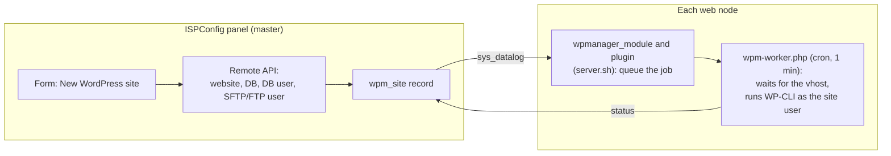

# ispconfig-wp-manager

> [!WARNING]
> **Pre-release software — use at your own risk.**
> This project is in an early development stage and has **not** been validated on production servers.
> It creates websites, databases and system users and runs commands on your nodes.
> Test it only on a disposable ISPConfig installation (for example a VM snapshot), keep backups,
> and read the code before running it. The authors accept no liability for data loss or downtime
> (see [LICENSE](LICENSE)).

An [ISPConfig 3](https://www.ispconfig.org) module to deploy, clone and keep WordPress sites updated
across one or more ISPConfig nodes — a free, open source alternative to commercial "WordPress toolkits".

## Features

Everything below works in the test environment: ISPConfig 3.3, Ubuntu 24.04, Apache, a master and a second web node
(see [docs/compatibility.md](docs/compatibility.md)). It has not run on production servers yet.

- **New WordPress site**: website, database, database user, SFTP or FTP user and WordPress in one form, with
  per-site PHP version, language, plugins and theme, and a settings page for the defaults.
- **Existing sites**: WordPress installs already on the node are detected and added to the list.
- **Sites in folders**: WordPress in `example.com/blog` of an existing website, with its own database, kept apart from
  the backups and restores of the site in `web/`.
- **Update overview**: core, plugin and theme updates of every site, per node and per site.
- **Safe updates**: a health check, a backup and an automatic rollback around every update, with a separate
  button for a new major version of WordPress.
- **Automatic updates**, on by default: plugins, themes and minor WordPress releases.
- **Backups and restore** from the site page, optionally without `wp-content/uploads` on large sites. They are meant
  for rollbacks and do not replace the backups of ISPConfig.
- **Clone** to a new domain on the same node or on another one, replacing the old address everywhere in the database,
  serialized data included.
- **Staging**, one per site: a copy that sends no mail from PHP and asks search engines to stay away, updated from
  production or pushed to production as a whole, with a list of what will be lost, typed confirmation, backup,
  maintenance mode, health check and automatic rollback.
- **WP-Cron switch**: move a site between WP-Cron and a real cron job.
- **Maintenance tools**: maintenance mode that lets logged-in users through, one-click login to wp-admin with a
  temporary administrator, password reset of an administrator, debug mode with the log outside the web root for 24
  hours, and activation, deactivation and removal of plugins and themes with a health check and a way back.
- **Full removal** of a site: website, domains, users, cron jobs, databases and the database users nobody else uses,
  listed before a typed confirmation. No backup is taken: keep the backups of ISPConfig.
- **Clients and resellers** use the module on their own sites, within the limits of their ISPConfig package.
- **SSH keys** for the SFTP user, in the new site form and on the site page.
- **Security**: known vulnerabilities of WordPress, plugins and themes from Wordfence Intelligence (with your own free
  API key), with an email and an early automatic update when a fixed version exists; file permission check and fix;
  hardening switches per site.
- **Log**: who asked for what in the panel, when and from where, with the outcome on the node, kept for a year.
- **Emails**, with the mail settings of ISPConfig: a notice when a site is ready (never with passwords), an alert at
  once for rollbacks and failures, and a daily or weekly summary.
- **Safety first**: dry-run mode, no changes to folders that are not empty, everything runs as the site user,
  every WP-CLI command in a PHP sandbox.

> [!IMPORTANT]
> Automatic updates start as soon as `dry_run` is turned off, also on sites this module did not create.
> To look at a node without changing it, set `updates.auto` to `n` first. See
> [docs/installation.md](docs/installation.md).

## Status / roadmap

Milestones 0.1 to 0.5 are done, and so is the code of 1.0. What is left before 1.0 is the first pilot on production
servers. The detailed list is in [ROADMAP.md](ROADMAP.md).

## How it works



Details in [docs/architecture.md](docs/architecture.md).

## Requirements

- ISPConfig 3.3 (tested on 3.3.2 and 3.3.3), on a single server or a multiserver setup (tested with a master and one
  node); see [docs/compatibility.md](docs/compatibility.md)
- PHP 8.1+ with the `sodium` and `curl` extensions on the master and on every web node
- [WP-CLI](https://wp-cli.org) in `/usr/local/bin/wp` on every web node, plus `sudo`, `rsync`, `tar`, `gzip`
  and a MySQL or MariaDB client
- A dedicated ISPConfig remote user (System → Remote Users) with the permissions listed in
  [docs/installation.md](docs/installation.md)

## Installation

See [docs/installation.md](docs/installation.md). **Read the warning above first.**

## Documentation

- [Administrator guide](docs/admin-guide.md): daily use of the module, and what to do when something goes wrong
- [Client guide](docs/client-guide.md): what clients and resellers can do with their sites, to pass on to them
- [Compatibility](docs/compatibility.md): what the module has run on, and how far
- [Architecture](docs/architecture.md) and [security](docs/security.md): how it works and what it protects

## Testing

Automated tests cover the logic that does not need a live server; everything else follows the
manual test plan in [docs/testing.md](docs/testing.md). `dev/regression.sh` checks in a test VM that
existing sites did not change.

```bash
composer install
composer test
```

## Security

The design, what a review found and the risks that remain are in [docs/security.md](docs/security.md).

> [!IMPORTANT]
> WP-CLI runs outside the jail of a site, as its own user, limited by a PHP sandbox that is not a jail. If you rely on
> the jail to contain your clients, read [WP-CLI runs outside the jail](docs/security.md#wp-cli-runs-outside-the-jail)
> first.

## Contributing

Contributions are welcome — see [CONTRIBUTING.md](CONTRIBUTING.md).

## License

BSD 3-Clause, the same license as ISPConfig. See [LICENSE](LICENSE).
ISPConfig and WordPress are trademarks of their respective owners; this project is not affiliated with them.
